  

# 🌐 Awesome Social Networking & Peer Collaboration 🤝

  
  
  
  
  
  
  

> **A definitive, curated directory of SaaS community hubs, federated social networks, encrypted peer-to-peer messaging platforms, real-time team collaboration tools, and wearable AI companions.** 🚀

Whether you are building a creator community, deploying enterprise team communications, establishing federated ActivityPub instances, or self-hosting local-first encrypted chat, this repository organizes the best-in-class hosted solutions and open-source software with verifiable stars, market dynamics, and transparent pricing.

---

## 📑 Table of Contents

- [📊 Sector Overview & Market Dynamics](#-sector-overview--market-dynamics)
- [☁️ SaaS / Hosted Platforms](#️-saas--hosted-platforms)
- [💻 Open-Source GitHub Projects](#-open-source-github-projects)
- [🏗️ Architectural Frameworks & Patterns](#️-architectural-frameworks--patterns)
- [📈 Star History](#-star-history)
- [💖 Support & Sponsorship](#-support--sponsorship)
- [🤝 How to Contribute](#-how-to-contribute)
- [⚠️ Disclaimer](#️-disclaimer)

---

## 📊 Sector Overview & Market Dynamics

The global team collaboration, enterprise messaging, and community software market is valued at approximately **$31.5 Billion (2024–2026)** and is projected to surpass **$58 Billion by 2030** at a compound annual growth rate (CAGR) of ~13.2%. 

The market dynamics exhibit a **bifurcated, moderately concentrated structure**:
- **Workplace & Consumer Messaging** is heavily concentrated among trillion-dollar cloud incumbents and decacorns (Salesforce/Slack, Microsoft Teams, Discord, and Telegram), which benefit from deep enterprise lock-in and high-density network effects.
- **Community, Creator & Sovereign Networks** remain **highly fragmented**, rapidly expanding around specialized monetization platforms (Circle, Mighty Networks, Bettermode) and an accelerating wave of open standards (**ActivityPub / W3C**, **Matrix**, **Nostr**, and **AT Protocol**) driven by user demand for privacy, algorithmic autonomy, and sovereign data ownership.

---

## ☁️ SaaS / Hosted Platforms

The table below catalogs premier hosted community, team collaboration, and social networking services, sorted descending by **Company Scale (Valuation / Revenue)**.

| Platform | Category & Core Focus | Company Scale (Valuation / Rev) | Starting Tier Pricing | Free Tier / Trial Limits |
| :--- | :--- | :--- | :--- | :--- |
| **[Slack](https://slack.com)** | 💬 Enterprise Team Messaging & Workflows | **$27.7B** *(Acquired by Salesforce)* | **$7.25 / user / month** *(Pro plan, billed annually)* | **Free forever plan**: 90-day message & file history, 10 app integrations, 1:1 huddles |
| **[Discord](https://discord.com)** | 🎙️ Voice, Video, Text & Gaming Communities | **$15.0B** *(Valuation; ~$600M ARR)* | **$2.99 / month** *(Nitro Basic) / $9.99 / mo (Nitro)* | **Free forever plan**: Unlimited voice/video channels, 500,000 members/server, 10MB upload limit |
| **[Telegram Communities](https://telegram.org)** | 📢 Cloud Broadcast Channels & Supergroups | **$30.0B** *(Est. Valuation; bondholder debt)* | **$4.99 / month** *(Telegram Premium)* | **Free forever plan**: Up to 200,000 members per supergroup, 2GB file upload limit |
| **[Guilded](https://guilded.gg)** | 🎮 Structured Community & Gaming Collaboration | **$400M** *(Acquired by Roblox)* | **$0.00** *(Fully subsidized by Roblox)* | **Free forever plan**: 100% free with unlimited 1080p 60fps streaming, voice channels, and bot APIs |
| **[Mighty Networks](https://mightynetworks.com)** | 👥 Creator Courses, Events & Member Networks | **$300M** *(Valuation; $67M+ funding raised)* | **$41.00 / month** *(Community Plan, billed annually)* | **14-day free trial**: Full access to Community & Courses features without charges during trial |
| **[Circle (Circle.so)](https://circle.so)** | 🎓 Creator Memberships & Community Spaces | **$250M** *(Valuation; $30M+ funding raised)* | **$89.00 / month** *(Basic plan, billed annually)* | **14-day free trial**: Complete access to community spaces, payments, and member directories |
| **[Bettermode](https://bettermode.com)** | 🏢 Customer Community & Self-Service Support | **$80M** *(Valuation; ~$10M ARR; fmr Tribe)* | **$59.00 / month** *(Lite Plan, billed annually)* | **14-day free trial**: Access to community builders, customization blocks, and API webhooks |
| **[Geneva](https://geneva.com)** | 📱 Group Chat, Audio Rooms & Local Clubs | **$60M** *(Valuation; venture-backed by Benchmark)* | **Free / Ad-free** *(Current beta model)* | **Free forever plan**: Unlimited audio rooms, threads, calendar events, and member rosters |

---

## 💻 Open-Source GitHub Projects

Curated open-source software, self-hostable Discord/Slack alternatives, federated social networks, and peer-to-peer hubs. **Sorted descending by verified GitHub_Stars_Count.**

| Project | GitHub_Stars | Focus & Description | Protocol / Stack |
| :--- | :---: | :--- | :--- |
| **[Syncthing](https://github.com/syncthing/syncthing)** |  | Open-source continuous peer-to-peer file synchronization and collaboration engine. | Go / P2P Block Exchange |
| **[Mastodon](https://github.com/mastodon/mastodon)** |  | Decentralized, federated microblogging platform implementing the W3C ActivityPub protocol. | Ruby on Rails / ActivityPub |
| **[Discourse](https://github.com/discourse/discourse)** |  | Modern discussion platform and civilized community forum software built for the open web. | Ruby on Rails / PostgreSQL |
| **[Rocket.Chat](https://github.com/RocketChat/Rocket.Chat)** |  | Open-source communications hub for team chat, omnichannel customer support, and Matrix federation. | TypeScript / Node.js |
| **[Mattermost](https://github.com/mattermost/mattermost)** |  | Secure, self-hosted Slack alternative engineered for technical, DevOps, and defense teams. | Go / React / PostgreSQL |
| **[Jitsi Meet](https://github.com/jitsi/jitsi-meet)** |  | Secure, low-latency, scalable open-source video conferencing and screen sharing application. | JavaScript / WebRTC |
| **[Zulip](https://github.com/zulip/zulip)** |  | Real-time team collaboration chat with unique, highly productive topic-based email threading. | Python / Django / TypeScript |
| **[Forem](https://github.com/forem/forem)** |  | Open-source software powering DEV.to and independent developer community networks. | Ruby on Rails / PostgreSQL |
| **[SimpleX Chat](https://github.com/simplex-chat/simplex-chat)** |  | The first privacy-first peer messaging network operating without any user identifiers or phone numbers. | Haskell / Kotlin / Swift |
| **[Flarum](https://github.com/flarum/flarum)** |  | Simple, delightful, ultra-fast next-generation open-source community forum software. | PHP / Mithril.js / MySQL |
| **[PeerTube](https://github.com/Chocobozzz/PeerTube)** |  | ActivityPub-federated decentralized video streaming platform using P2P in-browser distribution. | TypeScript / WebTorrent |
| **[NodeBB](https://github.com/NodeBB/NodeBB)** |  | Modern Node.js discussion forum engine with real-time WebSockets, streaming notifications, and plugins. | Node.js / Redis / Mongo |
| **[Lemmy](https://github.com/LemmyNet/lemmy)** |  | Federated, link-aggregating Reddit alternative built on Rust and ActivityPub across the Fediverse. | Rust / Actix / ActivityPub |
| **[Element Web](https://github.com/element-hq/element-web)** |  | Flagship web client for the Matrix decentralized, end-to-end encrypted communications network. | TypeScript / Matrix protocol |
| **[Nostr Protocol](https://github.com/nostr-protocol/nostr)** |  | Censorship-resistant, decentralized social networking protocol based on simple cryptographic relays. | Cryptographic Relays (WSS) |
| **[Matrix Synapse](https://github.com/matrix-org/synapse)** |  | Reference open-source server implementation for the Matrix secure federated communication standard. | Python / Twisted / Matrix |
| **[Owncast](https://github.com/owncast/owncast)** |  | Independent, self-hosted live video and audio streaming server with built-in interactive peer chat. | Go / WebRTC / HLS |
| **[Misskey](https://github.com/misskey-dev/misskey)** |  | Feature-rich, highly customizable federated microblogging and social networking platform. | TypeScript / ActivityPub |
| **[AT Protocol](https://github.com/bluesky-social/atproto)** |  | Authenticated Transfer Protocol powering Bluesky social networking, Personal Data Servers (PDS), and relays. | TypeScript / Lexicon schemas |
| **[Mumble](https://github.com/mumble-voip/mumble)** |  | Low-latency, high quality voice chat client and server architecture designed for gaming and peer groups. | C++ / Qt / Opus |
| **[Pixelfed](https://github.com/pixelfed/pixelfed)** |  | Open-source, federated photo-sharing and media platform alternative to Instagram on ActivityPub. | PHP / Laravel / ActivityPub |
| **[HumHub](https://github.com/humhub/humhub)** |  | Modular open-source social network kit and intranet collaboration framework for organizations. | PHP / Yii 2 / MySQL |
| **[WriteFreely](https://github.com/writefreely/writefreely)** |  | Clean, distraction-free federated blogging and community publishing platform for the Fediverse. | Go / ActivityPub |
| **[Revolt Backend](https://github.com/stoatchat/stoatchat)** |  | Privacy-first, open-source chat engine alternative to Discord built with high-throughput WebSocket APIs. | Rust / Actix / MongoDB |
| **[Spacebar](https://github.com/spacebarchat/server)** |  | Free, self-hostable Discord-compatible chat, voice, and video communications server. | TypeScript / Express / WebSockets |
| **[Delta Chat Core](https://github.com/chatmail/core)** |  | Rust engine powering Delta Chat: decentralized peer messaging built on standard email (IMAP/SMTP) rails. | Rust / Autocrypt / IMAP |
| **[Chums](https://github.com/lcoutodemos/chums)** |  | Local-first companion app bridging desktop AI coding agents to Apple Watch & iPhone via voice and Tailscale. | Swift / WhisperKit / Kokoro |

---

## 🏗️ Architectural Frameworks & Patterns

For architects and engineering teams designing modern collaborative digital spaces:

1. **Structured Discourse + Real-Time Sync**:
   - Combine **[Discourse](https://github.com/discourse/discourse)** or **[Flarum](https://github.com/flarum/flarum)** for indexed, searchable technical discussions.
   - Pair with **[Zulip](https://github.com/zulip/zulip)**, **[Mattermost](https://github.com/mattermost/mattermost)**, or **[Rocket.Chat](https://github.com/RocketChat/Rocket.Chat)** for low-latency operational chat.
2. **Federated & Sovereign Ecosystems**:
   - Connect user spaces across independent instances via **ActivityPub** (Mastodon, Lemmy, Pixelfed) or **Matrix Synapse** with end-to-end encryption.
   - Leverage **[Nostr](https://github.com/nostr-protocol/nostr)** relays or **[AT Protocol](https://github.com/bluesky-social/atproto)** for identity portability independent of any central server.
3. **Local-First & P2P Data Channels**:
   - Use **[Syncthing](https://github.com/syncthing/syncthing)** or **[SimpleX Chat](https://github.com/simplex-chat/simplex-chat)** to eliminate metadata tracking and avoid central database bottlenecks.
   - Employ local-first AI bridges like **[Chums](https://github.com/lcoutodemos/chums)** for private audio and telemetry pipelines across personal devices.

---

## 📈 Star History

---

## 💖 Support & Sponsorship

Thank you so much for exploring this curated repository! If you find this directory valuable for your projects, architecture research, or open-source journey, please consider supporting the project:

- ⭐ **Star** this repository to help other builders discover it.
- 🍴 **Fork & Contribute** to expand coverage across emerging federated tools and protocols.
- 📢 **Share** with your network, engineering colleagues, and community builders.
- ☕ **Buy me a coffee**: If you'd like to back ongoing maintenance and curation of open-source resources, please consider sponsoring via the [GitHub Sponsor Dashboard](https://github.com/sponsors/ishandutta2007).

---

## 🤝 How to Contribute

Contributions are warmly encouraged! Follow these steps to submit additions or updates:

1. **Fork** this repository. 🍴
2. **Add or modify** items in `README.md` following the established table structure. ✍️
3. Provide:
   - Official platform or repository name.
   - Valid link to the site or GitHub repository.
   - Specific pricing/limits (for SaaS) or accurate Stars_Badge (for Open-Source).
4. Submit a **Pull Request** with a clear explanation of the addition. 📬

---

## ⚠️ Disclaimer

- This list is **community-curated** for educational, architectural, and evaluation purposes; it does not constitute commercial endorsement.
- Self-hosting federated social nodes or communication servers requires diligent security practices: enforce strict TLS certificates, monitor disk I/O, configure automated off-site backups, and maintain clear moderation policies.
- Always review local permissions and sandbox execution parameters when running peer-connected agent tools.

---

  <b>Built with ❤️ for community builders, open-source maintainers, distributed teams, and privacy advocates.</b> 
  Empowering open, federated, and decentralized social networks for everyone.

